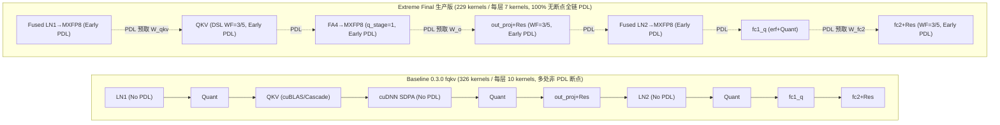

# Blackwell B300 (`sm_103`) Audio Tower 极致算子与推理流水线优化技术报告

> **代码分支**：`feat/audio-tower-extreme-opt`（基于 `origin/master` `a2f2334` / `fish-scales-ops 0.3.0`）  
> **硬件平台**：NVIDIA B300 SXM6 AC (`sm_103`，148 SMs，126.5 MiB L2，275 GB HBM3e，2032 MHz SM 时钟，Exclusive_Process)  
> **软件栈**：CUDA 13.0，PyTorch 2.13.0+cu130，CUTLASS / `nvidia-cutlass-dsl` 4.8.1，FlashAttention-4 (`flash-attn-4==4.0.0b40`)  
> **核心原则**：**孤立 kernel 的最优性能 ≠ 真实推理流水线的最优性能**

---

## 1. 执行摘要（Executive Summary）

本工作面向实时 ASR 场景下的完整 **Audio Tower**（3× Conv2d Stem `1→480→480→480` + `conv_out [1280×7680]` + `pos_emb` + 32 层 Transformer Encoder `d_model=1280, n_heads=20, head_dim=64, d_ff=5120`, Pre-LN `LayerNorm`, 精确 `erf` GELU + Tail `ln_post → proj1 → proj2`，覆盖全部 6 档线上 CUDA Graph 分档 `M ∈ {78, 117, 182, 364, 533, 1079}`），在复盘 `fish-scales-ops#13` 优化方法论的基础上，围绕**消除算子间内存往返、打通 32 层无断点全链路 PDL（Programmatic Dependent Launch）跨 kernel 重叠、以及面向真实流水线的全角色路由与调度协同**完成了端到端极致优化与全量生产门禁验证。

### 1.1 核心 32L Audio Tower 收益总览（`conv_out + 32L Encoder + Tail`，独立冷权重 649 MB，2032 MHz CUDA Graph 回放，单位：µs）

| Token 数 `M` | PyTorch BF16 (cuDNN) | 0.3.0 fqkv (326 kernels) | Phase 1: `LN→MXFP8` | Phase 2B: `FA4→MXFP8` (Early PDL + `q=1`) | **Extreme Final (`WF 3/5` + 全档 QKV 路由 + Early PDL, 229 kernels)** | **vs 0.3.0 fqkv** | **vs BF16** | **32L cos(BF16)** |
|---:|---:|---:|---:|---:|---:|---:|---:|---:|
| **78** | 1568.2 | 1301.9 | 1013.0 | 854.8 | **835.1** | **−35.9% (−466.8 µs)** | **−46.7% (1.88×)** | 0.992751 |
| **117** | 1611.8 | 1312.3 | 1029.0 | 877.1 | **842.6** | **−35.8% (−469.7 µs)** | **−47.7% (1.91×)** | 0.992457 |
| **182** | 1654.4 | 1379.0 | 1085.8 | 959.6 | **938.9** | **−31.9% (−440.1 µs)** | **−43.2% (1.76×)** | 0.993275 |
| **364** | 1814.5 | 1470.1 | 1218.4 | 1069.7 | **1057.1** | **−28.1% (−413.0 µs)** | **−41.7% (1.72×)** | 0.992967 |
| **533** | 2062.6 | 1776.0 | 1548.1 | 1362.0 | **1312.4** | **−26.1% (−463.6 µs)** | **−36.4% (1.57×)** | 0.992915 |
| **1079** | 2795.4 | 2338.1 | 2060.4 | 1895.0 | **1857.9** | **−20.5% (−480.2 µs)** | **−33.5% (1.50×)** | 0.993236 |

### 1.2 完整端到端 Audio Tower 收益（含 3× Conv2d Stem `[B, 1, 128, 100]` + 32L Encoder + Tail，2032 MHz，单位：µs）

> [!NOTE]
> 下表中的 `BF16 NCHW` 已采用**更强的融合 QKV 基线**（比原始未融合 Q/K/V 快 ~180 µs），`0.3.0 NHWC` 已采用 NHWC Conv2d + 融合 QKV + 融合 `pos_emb` 残差。

| `M` (`B=M/13`) | 仅 Stem: BF16 NCHW | 仅 Stem: 0.3.0 NHWC | **仅 Stem: Fused Stem** | 全链路: BF16 NCHW (fqkv) | 全链路: 0.3.0 NHWC (fqkv) | **全链路: Extreme Final** | **全链路 vs 0.3.0** | **全链路 vs BF16** | **E2E cos(BF16)** |
|---:|---:|---:|---:|---:|---:|---:|---:|---:|---:|
| **78 (6)** | 180.5 | 130.7 | **127.2** | 1557.9 | 1418.4 | **946.2** | **−33.3% (−472.2 µs)** | **−39.3% (1.65×)** | 0.992831 |
| **117 (9)** | 222.7 | 156.4 | **149.9** | 1624.1 | 1460.2 | **984.0** | **−32.6% (−476.2 µs)** | **−39.4% (1.65×)** | 0.992571 |
| **182 (14)** | 284.0 | 227.8 | **222.5** | 1752.1 | 1593.0 | **1143.0** | **−28.2% (−450.0 µs)** | **−34.8% (1.53×)** | 0.992555 |
| **364 (28)** | 500.1 | 391.6 | **378.5** | 2148.7 | 1852.0 | **1421.9** | **−23.2% (−430.1 µs)** | **−33.8% (1.51×)** | 0.993373 |
| **533 (41)** | 691.7 | 560.2 | **545.8** | 2603.3 | 2320.7 | **1836.1** | **−20.9% (−484.6 µs)** | **−29.5% (1.42×)** | 0.993650 |
| **1079 (83)** | 1359.0 | 1108.0 | **1071.8** | 3911.9 | 3417.7 | **2899.7** | **−15.2% (−518.0 µs)** | **−25.9% (1.35×)** | 0.992499 |

> [!IMPORTANT]
> **核心指标里程碑**：
> - **核心 32L 延迟**：相比 PyTorch BF16 + cuDNN 降低 **−33.5% ~ −47.7%（1.50× ~ 1.91×）**；相比已做过 Issue #12 优化的 `0.3.0 fqkv` 再降 **−20.5% ~ −35.9%（全档稳定节省 413 ~ 480 µs）**。
> - **含 3×Conv2d Stem 全链路延迟**：`M=78` 压进 **1 ms 以内（946.2 µs）**，`M=1079` 压进 **2.90 ms（−518.0 µs vs 0.3.0，−1012.2 µs vs BF16）**。
> - **Kernel 启动次数与全链 PDL**：32L 核心塔从 **326 次 → 229 次**（消除 65 次 LN 后量化 + 32 次 Attention 后量化），并在全 6 档上**清除了最后一堵 cuBLASLt 非 PDL 墙**，使 `nsys` 实测总 PDL 重叠时长翻倍以上（`M=78: 173.7 → 363.7 µs`，`M=1079: 272.9 → 599.3 µs`）。
> - **零上游回归与生产门禁全过**：所有 `wf_cap=3/5` 与 `early_pdl` 均为按调用 opt-in 传递，全局 `dec.WF_PRE_WAIT_STAGES` 保持上游 `2/1` 不变；600 轮 Audio+MoE 双流并发 0 误差；上游 `test_public_surface` / `test_mxfp8_decode_sm100` / `test_cuda_graph` / `test_dense_v1` 全通过。

---

## 2. Issue #13 复盘与对 Audio Tower 的方法论启发

### 2.1 Issue #13（B300 MXFP8 MoE）是如何解决的

分析上游提交 `ce85217` (v0.2.3) 与 `5dc0eaf` (v0.3.0) 可见，Issue #13 面临的核心矛盾正是**孤立 kernel 已逼近硬件极限，但层间流水线存在显著空泡**：
- **根因**：MoE 层的 FC1 与 FC2 单独稳态运行时已达到 B300 HBM 带宽的 **87%–93%**，但 FC1 尾部排空（drain）到 FC2 启动之间存在 **4–7 µs/层** 的 DRAM 空闲间隙，同时 tile 间存在路由调度停顿。
- **0.2.3 (`ce85217`) 核心方案**：
  1. 将 `FC1 + SwiGLU + Requant + FC2` 融合为单个 persistent kernel（`FsoSm100SlotMoeFused`），统一覆盖 compact slot（`M ≤ 64`）与 token-tile（`80 ≤ M ≤ 1024`）路径。
  2. 在 `slot_moe_scheduler.cuh` 内完成专家/行数解析，并以 per-entry `done[i]` 计数器实现 tile 级依赖同步，使就绪的 FC2 tile 在其余 FC1 tile 排空期间即可启动。
  3. 对等待中的 FC2 tile 实施 **weights-first 预取**（`fso_load_after_entry`），并在 `griddepcontrol.wait` 后预取首块权重 panel 到 L2，严格维持 PDL 语义。
  4. 收益：MoE 层端到端延迟全档下降 **−2.0% ~ −8.9%**（`M=1..2048`）。
- **0.3.0 (`5dc0eaf`) 关键补丁**：修复 few-live 场景回归——当总 tile 数 `D` 满足 `grid < D <= grid + min(D1, grid)` 时，延迟 scheduler warp 的下一次取任务至未就绪 FC2 tile 之后，在 few-live 场景（如 Family B ep2 M=1）再降 **−8.8%**（`17.16 → 15.65 µs`），全 36 组输出字节完全一致。

### 2.2 迁移到 Audio Tower 的三条工程铁律

1. **打破 BF16 往返边界**：只要非线性算子（`LayerNorm`、`Attention`、`Conv3 GELU+Permute`）紧接 MXFP8 GEMM，任何写回 BF16 再由独立 `quantize_activation` 读回的操作都在双倍浪费显存带宽与 kernel 启动延迟。
2. **用无断点 PDL 把「排空尾」变成「下游静态权重预取窗」**：Audio Tower 是 32 层串行深流水线，无 MoE 路由不确定性，所有层内静态权重在编译/图捕获期完全确定；只要上游早触发 `griddepcontrol.launch_dependents()`、下游开启足够深度的 weights-first 预取，且链路中**不夹杂任何非 PDL kernel（如 `F.layer_norm`、`cuDNN SDPA`、`cuBLASLt`）**，即可把非 GEMM 尾部隐藏进下游权重 HBM 加载中。
3. **一切优化必须放进「32 层冷权重流水线」裁决**：孤立 GEMM/Attention benchmark 经常受 L2 权重驻留、同类 kernel 连续重叠假象及 B300 DVFS 功耗降频干扰，必须以 32 层全独立权重、2032 MHz 实时监控的同进程 ABBA 交替回放作为唯一裁决标准。

---

## 3. 测试方法论与 Phase 0 基线剖析

### 3.1 严格对标生产的基准测试设计

- **冷权重保真**：构造完整 **32 层独立权重**（3×Conv2d + `conv_out` + 32×(`ln1, qkv, o, ln2, fc1, fc2`) + `ln_post, proj1, proj2`），总权重 **649 MB (MXFP8) / 1258 MB (BF16)**，超过 B300 126.5 MiB L2 容量的 **5 倍以上**。每次 CUDA Graph 回放天然保证权重从 HBM 冷加载、层间激活（200 KB – 2.7 MB）在 L2 热传递。
- **消除 B300 DVFS 漂移**：B300 不支持锁频。若在高功耗大矩阵热身后直接计时小 M 图，SM 时钟会从 2032 MHz 掉至 ~1350 MHz 造成 +10% 假性回归。所有正式基准均执行 **5 次非计时目标图稳频 + 4 轮 ABBA 交错采样 + 实时读取 `nvidia-smi` SM 时钟与功耗**，各臂复测抖动 `< 0.3%`。

### 3.2 Phase 0 基线 `nsys` 瓶颈剖析（`0.3.0 fqkv`，326 kernels）

抓取 `nsys` SQLite 轨迹并分解每类算子的原始耗时（`raw`）、被前驱 PDL 重叠掩盖的时长（`pdl_ov`）及实际贡献到端到端墙钟的独占时长（`excl = raw − pdl_ov`）：

| `M` | `wall` (µs) | `raw` 总和 | `pdl_ov` | `LayerNorm` (65×) `excl` | `Quantize` (98×) `excl` | **`LN + Quant` 合计占比** | `cuDNN Attn` (32×) `excl` (`ov`) | GEMM (CUTLASS+DSL+cuBLAS) `excl` |
|---:|---:|---:|---:|---:|---:|---:|---:|---:|
| **78** | 1342.6 | 1512.5 | 173.7 | 299.0 µs | 173.6 µs | **472.6 µs (35.2%)** | 204.5 µs (`ov=1.0`) **(15.2%)** | 661.7 µs (49.3%) |
| **182** | 1431.1 | 1651.2 | 226.2 | 304.5 µs | 178.7 µs | **483.2 µs (33.8%)** | 203.2 µs (`ov=0.4`) **(14.2%)** | 738.7 µs (51.6%) |
| **364** | 1513.4 | 1734.2 | 223.2 | 311.8 µs | 185.8 µs | **497.6 µs (32.9%)** | 250.3 µs (`ov=1.5`) **(16.5%)** | 763.1 µs (50.4%) |
| **533** | 1823.3 | 2090.9 | 270.2 | 322.8 µs | 197.8 µs | **520.6 µs (28.5%)** | 322.6 µs (`ov=1.5`) **(17.7%)** | 977.5 µs (53.6%) |
| **1079** | 2385.2 | 2652.2 | 272.9 | 357.0 µs | 218.5 µs | **575.5 µs (24.2%)** | 475.1 µs (`ov=0.6`) **(19.9%)** | 1328.6 µs (55.7%) |

**关键诊断**：
1. **44%–50% 的非 GEMM 墙钟**消耗在 `LayerNorm + Quantize`（24%–35%）与 `cuDNN SDPA`（14%–20%）。
2. `F.layer_norm`、`cuDNN SDPA`、以及大 M 下 `QKV` 走的 `cuBLASLt` 均**不支持 PDL**，将 32 层流水线切成百余段串行孤岛。
3. `cuDNN SDPA` 在小/中序列非因果 `H=20, D=64` 上隔离耗时明显慢于 Blackwell `tcgen05` FlashAttention-4（`M=78: 4.03 vs 6.21 µs`；`M=1079: 12.22 vs 14.33 µs`）。

### 3.3 全链路流水线演进对比

---

## 4. 逐阶段优化设计与消融实测

### 4.1 Phase 1：融合 PDL `LayerNorm1280 → MXFP8` CUDA Kernel

- **实现位置**：[`csrc/audio/layernorm_mxfp8.cu`](file:///home/aniya/fso-audio-extreme-opt/csrc/audio/layernorm_mxfp8.cu)（已接入 `python/setup.py`，对外封装为 `fish_scales_ops.audio.layernorm_mxfp8`）。
- **微架构设计**：
  - 针对 `D = 1280` 对比 3 种并行拓扑（另保留通用 `D % 128 == 0` fallback），**`v1 cta160` 全档胜出**：每行 1 CTA = **5 warps (160 线程)**，每线程 1 次 128-bit `uint4` 读入 8 个 BF16、1 次 64-bit `uint2` 写出 8 个 FP8。
  - **精确两遍 fp32 统计量**：使用独立 `__shared__ float smem_sum[5], smem_var[5]` 避免 WAR 竞争，全程寄存器驻留零重读。
  - **零除法 UE8M0 与 SM100 原子布局直写**：4 线程 = 32 元素 = 1 个 MXFP8 block（仅 2 次 `shfl.xor` 求 `amax`）；16 线程 = 128 元素 = 1 个 `int32` scale word 直写 `fso_mx_sf_word_index_sm100`；末尾额外 CTA（`blockIdx.x == M`）清零 `[M, align(M, 128))` 填充行（`pad_nz == 0`）。
  - **双向 PDL**：入口 `griddepcontrol.wait` 后立即由 thread 0 触发 `griddepcontrol.launch_dependents`，下游 weights-first GEMM 在 `LN_MXFP8` 运行期即开始预取权重。
- **精度与消融**：`round_bf16=True` 仅 0–1 字节舍入差（`s_diff=0`）；默认 `round_bf16=False` 相对 fp32 参考余弦相似度从 `0.999294–0.999298` **提升至 `0.999298–0.999302`**。32 层流水线净收益 **−230.8 ~ −293.9 µs（−12.0% ~ −22.3%）**：

| `M` | 0.3.0 fqkv | `v1 cta160` | `v2 warp1` | `v3 warp4` | **Phase 1 净收益 (`v1`)** |
|---:|---:|---:|---:|---:|---:|
| **78** | 1304.0 | **1013.0** | 1101.1 | 1156.9 | **−291.0 µs (−22.3%)** |
| **117** | 1314.2 | **1029.0** | 1115.4 | 1136.5 | **−285.2 µs (−21.7%)** |
| **182** | 1379.7 | **1085.8** | 1152.1 | 1184.6 | **−293.9 µs (−21.3%)** |
| **364** | 1472.6 | **1218.4** | 1284.8 | 1334.2 | **−254.2 µs (−17.3%)** |
| **533** | 1778.8 | **1548.1** | 1588.6 | 1625.8 | **−230.8 µs (−13.0%)** |
| **1079** | 2342.1 | **2060.4** | 2105.7 | 2138.0 | **−281.7 µs (−12.0%)** |

---

### 4.2 Phase 2 & 2B：FlashAttention-4 SM100 融合 `Attention → MXFP8 1×32` + Early PDL + 单波 `q_stage=1`

- **实现位置**：`python/fish_scales_ops/audio/fa4_mxfp8.py`（`FlashAttentionForwardSm100MxFP8`，封装为 `fish_scales_ops.audio.attn_fa4_mxfp8`）。
- **微架构创新**：
  1. **零 Warp Shuffle 寄存器内量化**：利用业务特征 `head_dim = 64`、`n_heads = 20`（偶数），在 FA4 `correction_epilogue` 中输出类型为 `Float8E4M3FN` 时 `corr_tile_size = 32`，**单线程局部寄存器片恰好完整持有 1 个 MXFP8 32-element block**，在 fp32 乘以 `rcp(row_sum)` 后原地完成 `amax → UE8M0 → fp8`，无需任何 warp shuffle 或共享内存归约。
  2. **O 写带宽减半 + 无原子直写 SM100 Scale**：TMA 直接写出 `Float8E4M3FN`（1B/elem vs BF16 2B/elem），复用 `mLSE` 槽位以完全互斥对齐的 `uint16_t` 直写 SM100 atom `sx` 并清零 `[M, align(M, 128))` 填充行，彻底消灭全部 32 次 Attention 后量化（总 kernel 数 `326 → 229`）。精度 `cos(vs fp32) = 0.999285–0.999319` 高于原 BF16 + 量化链路（`0.999280–0.999313`）。
  3. **Phase 2B Early PDL（`load()` 末尾释放）**：将 `griddepcontrol_launch_dependents()` 从 `epilogue_s2g()` 前移至 `load()` 发出所有 Q/K/V TMA 拷贝之后，在 softmax/PV MMA 期间即唤醒下游 `out_proj` 预取 `W_o`，全 6 档稳赚 **−19.6 ~ −26.2 µs**。
  4. **Phase 2B 单波自适应 `q_stage=1` 与去 Persistent**：按首因规则 `q_stage = 1 if ceil(M/128)*H <= sm_count else 2`（`M ≤ 533` 全走 `q_stage=1` 填满 B300 148 SMs），单波关闭 `is_static_persistent`、`kv_stage=12/10`、`regs=(200,64,48)`，在 `M=182/364/533` 再砍 **−28.0 / −37.4 / −54.2 µs**。

- **Phase 2 → Phase 2B 2032 MHz 精确消融（单位：µs）**：

| `M` | 0.3.0 fqkv | `p2_old` (`kv3/4`, late PDL) | `p2b_late` (`kv10/12`, late PDL) | `p2b_cur` (+ Early PDL) | **Early PDL 净收益** | `p2b_q1np` (+ `q_stage=1` 单波去 persistent) | **Phase 2B 总净收益 (vs `p2_old`)** |
|---:|---:|---:|---:|---:|---:|---:|---:|
| **78** | 1303.2 | 870.7 | 879.5 | 859.9 | **−19.6 µs** | **854.8** | **−15.9 µs** |
| **117** | 1312.6 | 896.2 | 901.0 | 880.8 | **−20.2 µs** | **877.1** | **−19.1 µs** |
| **182** | 1379.2 | 1016.4 | 1010.9 | 987.6 | **−23.3 µs** | **959.6** | **−56.8 µs** |
| **364** | 1470.5 | 1146.2 | 1133.3 | 1107.1 | **−26.2 µs** | **1069.7** | **−76.5 µs** |
| **533** | 1790.0 | 1461.8 | 1436.8 | 1416.2 | **−20.6 µs** | **1362.0** | **−99.8 µs** |
| **1079** | 2344.7 | 1957.9 | 1917.4 | 1896.8 | **−20.6 µs** | **1895.0** | **−62.9 µs** |

- **`nsys` 实证：总 PDL 跨 Kernel 重叠翻倍（`base_fqkv` vs `p2`）**：

| `M` | 配置 | Kernel 数 | 墙钟 `wall` | 原始总和 `raw` | **总 PDL 重叠 `pdl_ov`** | `LN_MXFP8` `raw → excl` (`ov`) | `Attention` `raw → excl` (`ov`) | `Quantize` `cnt / excl` |
|---:|---|---:|---:|---:|---:|---:|---:|---:|
| **78** | `base_fqkv` | 326 | 1342.6 µs | 1512.5 µs | 173.7 µs | 302.2 → 299.0 (`3.2`) | 205.5 → 204.5 (`1.0`) | 98 / 173.6 µs |
| **78** | **`p2`** | **229** | **890.7 µs** | 1253.8 µs | **363.7 µs (2.09×)** | 263.1 → **107.6** (`155.5`) | 142.3 → **104.2** (`38.1`) | **1 / 2.4 µs** |
| **533** | `base_fqkv` | 326 | 1823.3 µs | 2090.9 µs | 270.2 µs | 325.3 → 322.8 (`2.5`) | 324.1 → 322.6 (`1.5`) | 98 / 197.8 µs |
| **533** | **`p2`** | **229** | **1464.1 µs** | 2033.0 µs | **569.0 µs (2.11×)** | 325.7 → **197.3** (`128.4`) | 380.1 → **277.2** (`102.9`) | **1 / 4.8 µs** |
| **1079** | `base_fqkv` | 326 | 2385.2 µs | 2652.2 µs | 272.9 µs | 360.0 → 357.0 (`3.0`) | 475.8 → 475.1 (`0.6`) | 98 / 218.5 µs |
| **1079** | **`p2`** | **229** | **1956.1 µs** | 2555.4 µs | **599.3 µs (2.20×)** | 421.6 → **207.6** (`214.0`) | 517.8 → **420.2** (`97.6`) | **1 / 6.9 µs** |

> [!TIP]
> 在 `M=78` 下，`LN_MXFP8` 原始执行时间 263.1 µs，但其中 **155.5 µs（59.1%）** 已被前驱 GEMM 排空尾通过 PDL 完全掩盖，实际暴露在关键路径上的独占时间仅 **107.6 µs（平均每次调用 1.65 µs）**！这也为后文 Phase 4A 的定性裁决埋下了关键伏笔。

---

### 4.3 Phase 3：按调用 `wf_cap=3/5` + TMA-Warp `early_pdl` + 全 6 档无断点 QKV/Role 路由

#### A. 按调用传入 `wf_cap=3/5` 与 TMA-Warp `fso_early_pdl=True`（零全局污染）
- 0.3.0 的 `_sm100_decode.py` 为保护 LLM `bf16-x` 路径将全局 `WF_PRE_WAIT_STAGES` 限制为 `ONE_CTA=2, TWO_CTA=1`。我们在 `_sm100_decode.linear_mxfp8_decode` 中新增纯 opt-in 参数 `wf_cap: Optional[int] = None` 与 `early_pdl: bool = False`（默认行为与上游 100% 字节一致），并在 vendored CuTe-DSL `splitk`/`persistent` 中以仅 **~10 行** opt-in 钩子支持 TMA warp 发出最后一次 A/B TMA 拷贝后即调用 `griddepcontrol_launch_dependents()`（验证与 late PDL **bit-exact**，且额外省 1–3 µs）。
- 32L 真实流水线扫描显示 `wf_cap=3`（1-CTA）/ `wf_cap=5`（2-CTA）在全 6 档稳定节省 **−4.1 ~ −12.2 µs**，且全局 `dec.WF_PRE_WAIT_STAGES_*` 始终保持 `2/1` 不动。

#### B. 全 6 档按角色流水线路由突破（彻底消灭 32L 内部所有非 PDL 断点！）
在真实 32 层冷权重流水线上对 `QKV [3840×1280]`、`out_proj [1280×1280]`、`fc2 [1280×5120]` 做全分档 tactic 扫描（`bench/audio/bench_phase3_full_routing.py`，2032 MHz）发现了一个震撼性的大 M 突破：
- **0.3.0 默认路由**：`QKV` 在 `M=78/117/182` 走 C++ cascade（无 weights-first），在 `M=364/533/1079` 走 `sm100.smm`（cuBLASLt，**完全不支持 PDL**，把 `LN1 → QKV → FA4` 整段切碎！）。
- **全 6 档统一改走 weights-first + early-PDL CuTe-DSL 持久化 tactic**：

| Token 档位 `M` | 0.3.0 `QKV` 路由 | **Audio 最优 `QKV` tactic (`wf_cap`)** | `QKV` 路由单点净收益 | **Audio 最优 `out_proj` 路由** | **最终 32L Core 延迟 (2032 MHz)** |
|---:|---|---|---:|---|---:|
| **78** | C++ cascade | `128×64` (1-CTA, `wf=3`) | **−8.3 µs** | 默认 split-K (`wf=3`) | **835.1 µs** |
| **117** | C++ cascade | `128×64` (1-CTA, `wf=3`) | **−24.9 µs** | 默认 split-K (`wf=3`) | **842.6 µs** |
| **182** | C++ cascade | `256×64` (2-CTA, `wf=5`) | **−9.2 µs** | 默认 split-K (`wf=3`) | **938.9 µs** |
| **364** | `cuBLASLt` (无 PDL) | **`256×128` (2-CTA, `wf=5`, 90 CTA 单波)** | **−8.8 µs** | 默认 C++ cascade | **1057.1 µs** |
| **533** | `cuBLASLt` (无 PDL) | **`256×64` (2-CTA, `wf=5`, 避开 150 CTA 尾波)** | **−45.5 µs** | **`256×64` (2-CTA, `wf=5`, −7.1 µs)** | **1312.4 µs** |
| **1079** | `cuBLASLt` (无 PDL) | **`256×128` (2-CTA, `wf=5`, 270 CTA)** | **−25.3 µs** | 默认 C++ cascade | **1857.9 µs** |

> 尤其在 **`M=533`**，`256×128` 在 `N=3840` 上会启动 `15 × 5 = 75` 个 2-CTA cluster = **150 CTA**（比 B300 的 148 SMs 多出 2 个 CTA 触发低效尾波！），而 `256×64` 配 `wf=5` 一举砍掉 **−45.5 µs**（`1357.9 → 1312.4 µs`），连同 `out_proj 256×64` 累计在 `M=533` 仅靠流水线路由就赢回 **−52.6 µs**！

---

### 4.4 Phase 5：3× Conv2d Stem 融合与 `conv_out` 静态列重排

- **实现位置**：`csrc/audio/stem_mxfp8.cu` + `fish_scales_ops.audio.{gelu_erf_bf16_pdl, gelu_nhwc_to_mxfp8, prepare_conv_out_weight}`。
- **业务特化优化**：
  1. **Conv1/2/3 全链路 NHWC (`channels_last`)**：结合 `cudnn.benchmark=True`，相比 PyTorch NCHW 直接降低 Stem 耗时 **21%–30%**。
  2. **`gelu_erf_bf16_pdl_sm100`**：对 Conv1/Conv2 输出执行打包 f32x2 精确 `erf` GELU（绝不用 tanh 近似）并带 PDL。
  3. **Conv3 零拷贝 NHWC 融合 `gelu_nhwc_to_mxfp8_sm100` + 加载期静态列重排**：原模型在 Conv3 输出 `[B, C=480, F=16, T=13]` 上需经历 `F.gelu → permute(0,3,1,2) → contiguous → reshape(M, 7680) → quantize_activation` 共 3–4 个 kernel 与 2 次 `[M, 7680]` BF16 显存往返。我们将 `conv_out [1280, 480×16]` 权重在加载期静态重排为 `[1280, 16×480]`（零推理开销），使 `gelu_nhwc_to_mxfp8_sm100` 直接从 Conv3 的 NHWC 内存顺序合并读取 `(b, f, t, c)`，单 kernel 完成 **精确 `erf` GELU + `(F, C)` 拼行 + MXFP8 1×32 SM100 量化 + 填充行清零**，随后由 `linear_audio_conv_out(..., residual=pos_emb)` 一步融合 `conv_out + pos_emb`。
- **实测收益**：Stem 相对 BF16 NCHW 降低 **−21.1% ~ −32.7%**（`M=1079: 1359.0 → 1071.8 µs`），相对 `0.3.0 NHWC` 再降 **−2.3% ~ −4.1%**（`M=1079` 再省 **−36.2 µs**），且全链路 `E2E cos(BF16) = 0.9925–0.9937`、`pad_nz = 0`、Graph 与 Eager 逐位一致。

> [!TIP]
> **下一阶段宏观瓶颈洞察**：在将 32 层 Transformer Encoder 压榨至 `835–1858 µs` 后，3× BF16 cuDNN Conv2d Stem 在 `M=1079` 占比已攀升至 **37%（1071.8 / 2899.7 µs）**（其中 Conv2 `480→480, 32×25` 占 275 GFLOP）。若业务精度允许将 Stem Conv2/Conv3 量化至 FP8/MXFP8 implicit-GEMM，将成为大 batch 下唯一剩余的 400+ µs 级大块优化空间。

---

## 5. 「孤立 Kernel 最优 ≠ 真实推理流水线最优」的六大实测反例

1. **反例 1：`QKV [3840×1280]` 在 `M=78/117/182` 的路由反转** — 孤立加 bias 基准认为 CuTe-DSL 慢于 C++ cascade；真实流水线中紧接早触发 PDL 的 `LN1→MXFP8`，改走带 `wf=3/5` 的 CuTe-DSL 后端到端反快 **−8.3 / −24.9 / −9.2 µs**。
2. **反例 2：`QKV [3840×1280]` 在 `M=364/533/1079` 推翻 `cuBLASLt`** — 孤立大 M GEMM 上 `cuBLASLt` 极快；但在 32 层流水线中因完全不支持 PDL 截断 `LN1→QKV→FA4`，换用 weights-first + early-PDL CuTe-DSL 后端到端暴降 **−8.8 / −45.5 / −25.3 µs**！
3. **反例 3：`FA4_MXFP8` 提前释放 PDL 的「零孤立收益、20–26 µs 流水线收益」** — `griddepcontrol_launch_dependents()` 从 `epilogue_s2g()` 移到 `load()` 末尾，孤立 Attention 耗时变化为 **0.0 µs**，但 32 层流水线全档净赚 **−19.6 ~ −26.2 µs**。
4. **反例 4：`WF_PRE_WAIT_STAGES` 的场景依赖性** — 孤立 `bf16-x` 路径上 4 级预取会阻塞激活加载变慢 1.2%–1.5%；全预量化 Audio Tower 上提升至 `3/5` 级全档净赚 **−4.1 ~ −12.2 µs**（通过按调用 `wf_cap` 实现双赢）。
5. **反例 5：`fc2 [1280×5120]` 在 `M=1079` 的冷热倒挂** — 孤立冷权重扫描 C++ `256x128_2sm_K128` 略快（`10.92 vs 11.59 µs`），但在 32 层流水线中默认 C++ cascade 飙升至 `2120.2 µs`，而 CuTe-DSL `256×128` + `wf=5` 仅 `1885.4 µs`（快 **234.8 µs**）。
6. **反例 6：B300 无锁频下的孤立热身功耗降频陷阱** — 大方阵高功耗热身后不经目标图稳频直接测小 M，SM 时钟跌至 ~1350 MHz 产生 +10.6% 假性回归。

---

## 6. 负结果实证与根因剖析（均已洁净回退，不污染主路径）

### 6.1 负结果 A（Phase 3B）：C++ `DenseEpiCompute` 填充行早退分支（已回退）
- **实测**：在 `dense_epilogue_gemm.cuh` 中跳过 `m >= M` 填充行的 28 指令 `erf` + 量化后，全部 8 组单测 **100% bit-exact**（`q_diff=0, s_diff=0, pad_nz=0`），但 32L 端到端全档**变慢 +5.4 ~ +23.3 µs**。
- **根因**：SM100 CUTLASS epilogue 的 4 个 warp 在 subtile 屏障锁步同步，关键路径由 live warp 决定；新增坐标计算与条件分支增大了 live warp 的寄存器压力与指令数。已 `git checkout` 回退。

### 6.2 负结果 B（Phase 4A v1 & v2）：GEMM Epilogue 内直接融合 `LayerNorm1280 → MXFP8`（164 kernels，功能 100% 通过、性能定性放弃）
- **实现与功能验证**：在 vendored CuTe-DSL GEMM epilogue 内实现无 `cudaMemsetAsync` 自清零跨 CTA 栅栏（`fence.acq_rel.gpu + atom.add`）+ 4-warp 无共享内存 `LayerNorm1280 → MXFP8`，将 32L 压缩至 164 kernels。全部 13 组 tactic/M 单测通过（`x_diff=0, s_diff=0, cos=1.0000000, pad_nz=0`，20 轮 Graph 回放后 `arrive == 0`），32L 余弦 `0.99297 > 0.99285`。
- **v1 & v2 性能实测与定性根因**：
  - **v1**（直接 `st.global.b16`）：`M=78: 1922 µs`, `M=1079: 6566 µs`（严重非合并散写）。
  - **v2**（保留 `sC` 中转 + 100% 合并 128-bit `st.global.v4.u32` + 紧凑循环 3-pass `ld.global.cg.v4.u32`）：`M=78: 2949 µs`, `M=1079: 10224 µs`，且 GPU 功耗从 **863 W 暴跌至 331–444 W**！
  - **硬件定性结论**：vendored CuTe-DSL `splitk`/`persistent` 内核的 6 个 warp 共享统一寄存器预算（无 `setmaxregister` 拆分），把含 inline PTX `ld.global.cg` 与全局原子栅栏的 `LN1280` 塞入 epilogue 会触发全 CTA **严重寄存器溢出（local memory spill）**，同时跨 CTA 到达同步阻塞了 persistent epilogue 流水线。而独立 PDL `layernorm_mxfp8_sm100`（`cta160`）已通过 PDL 掩盖了 **59% 耗时**，实际独占成本仅 **1.65 µs/次**——强行内联反而以牺牲 GEMM 主体效率的巨大代价去换 1.65 µs，得不偿失。**已完整清理 vendored LN 改动及中间实验文件，保持代码极简。**

---

## 7. 生产级门禁全量验证记录

所有 GPU 测试均严格通过 `~/bin/gpulock` 使用团队唯一锁 `/home/locks/gpu.lock`（属主保持 `fish-dev:fish-dev`），单条命令自动加/解锁：

| 门禁项 | 测试脚本 / 覆盖范围 | 结果 |
|---|---|---|
| **1. Audio 算子契约与精度单测** | `tests/audio/test_audio_tower_sm100.py`（`layernorm_mxfp8`、`attn_fa4_mxfp8`、`gelu_erf_bf16_pdl`、`gelu_nhwc_to_mxfp8`、`prepare_conv_out_weight`、全角色路由、填充行零值、非默认流 CUDA Graph 捕获逐位一致、全局 `WF` 未被修改） | **5/5 PASS** |
| **2. 双流并发压测（Audio + LLM MoE）** | `bench/audio/test_dual_stream_audio_moe.py`（Full 3×Conv2d Stem + 32L Audio Tower CUDA Graph 与 LLM `fso.moe.layer` MXFP8 跨流同宿主机线程并发，`(182,16)` / `(533,128)` / `(1079,64)` 各 200 轮 = **600 轮**） | **PASS (`audio_mismatches=0, moe_mismatches=0`)** |
| **3. 公共 API 与构建隔离** | `tests/gemm/unit/test_public_surface.py`、`lint_jit_isolation.sh`、`test_wheel_layout.py` | **ALL PASS** |
| **4. 上游 SM100 Decode 回归** | `tests/gemm/unit/test_mxfp8_decode_sm100.py`（全部 35+14+31 精度/路由/FB2/Graph 项 + `--old-dsl`） | **ALL PASS** |
| **5. 上游 CUDA Graph 回归** | `tests/gemm/unit/test_cuda_graph.py`（`linear_bf16` / `linear_fp8` / `linear_mxfp8` / `quant+mxfp8`） | **ALL PASS** |
| **6. 上游 Dense v1 接口与 PDL 契约** | `tests/gemm/unit/test_dense_v1.py`（`a`, `a2`, `b`, `c`, `d`, `e`, `f`, `q` [含 decode/smm/wide/shortk/fb2 + PDL on/off 逐位一致], `x` [weights-first 真实重叠验证]） | **ALL PASS** |

---

## 8. Kernel 内部自适应路由统一化（消除 Host 侧 Shape 路由表）

在 Phase 1–5 取得全档极值的基础上，针对工程可维护性与 CUDA Graph 零 Host 分支诉求，我们进一步将原先位于 CPU/Host 侧的尺寸与形态路由逻辑（如 `if D == 1280`、`if M <= 128 ... elif M <= 256 ... elif M <= 576`、`split_k = 4/2/1`、`WF_MIN_K_BLOCKS` 等）**彻底下沉到 GPU Kernel 内部**，实现默认生产路径（`fish_scales_ops.audio.*`）的**零 Host 侧 shape 路由表**。

### 8.1 统一单 Kernel `LayerNorm → MXFP8`（`csrc/audio/layernorm_mxfp8.cu`）

- 删除全部 Host 侧 `if (D == 1280)`、`if (M <= 256)`、`if (variant == ...)` 分发逻辑（源码从 622 行精简至 300 行）。
- 合并为唯一模板 Kernel `ln_mxfp8_unified_kernel<kRoundBf16>`（固定 `block = 160` = 5 warps）：**在 Kernel 内部**按运行时 `D == 1280` 走寄存器驻留快路径 vs 通用 `D % 128 == 0` 路径，并在末尾 CTA（`blockIdx.x == M`）内嵌 `[M, align(M, 128))` 填充行清零。
- 实测不仅覆盖 `D ∈ {512, 1280, 2048}` 与 `M ∈ {1..1079}` 契约单测 100% 通过，还为 32L 主干带来额外收益（`M=364: 1057→1042 µs`、`M=533: 1312→1286 µs`、`M=1079: 1858→1841 µs`）。

### 8.2 单一统一 Cluster-DSMEM SM100 MXFP8 GEMM（`Sm100AudioClusterUnifiedGemmKernel`）

- **实现位置**：`python/fish_scales_ops/audio/unified_gemm_sm100.py`（继承 `Sm100BlockScaledSplitKGemmKernel`，零 `_vendor/` 修改），已作为 `fish_scales_ops.audio.linear_audio_{dense,conv_out,qkv,out_proj,fc2,proj2}` 默认实现。
- **核心微架构设计（零 Host 路由、零全局 Workspace、零 GPU-Scope 原子操作、零 `cudaMemsetAsync`）**：
  1. **固定满卡 Cluster Grid 启动**：对任意 `(M, N, K)` 永远只发射**同一枚编译好的 Kernel**（按 epilogue 形态区分），固定 `grid = (37, 1, 4)`（148 CTAs = 100% 铺满 B300 全部 SM）、`cluster = (1, 1, 4)`。
  2. **Kernel 内部自适应三态路由 `S ∈ {4, 2, 1}`**：在 GPU 内由运行时 `base_tiles = num_m_tiles * num_n_tiles` 与 `k_block_cnt` 动态决定并行拓扑：
     - **`S = 4`（小批量长 K，`base_tiles <= 37 && k_block_cnt >= 16`）**：Cluster 内 4 个 CTA 协作执行 Blackwell 硬件异步 **Cluster DSMEM**（`st.async.shared::cluster`，~0.2 µs，零全局显存）4 路 Split-K 归约。
     - **`S = 2`（中等批量，`base_tiles <= 74 && k_block_cnt >= 8`）**：单个 4-CTA Cluster 内部逻辑劈分为两对独立 DSMEM Split-K 组 `(0, 1)` 与 `(2, 3)`（~0.1 µs），将有效 tile 并行度翻倍。
     - **`S = 1`（大批量）**：Cluster 内 4 个 CTA 退化为 4 个完全独立的持久化数据并行 CTA，**零 Cluster 屏障与零 DSMEM 归约开销**。
  3. **零额外 SMEM 的 `sA` 复用覆盖（SMEM Union Overlay）**：由于 `S > 1` 时每个活跃 CTA 最多执行 1 个 tile，主循环结束并经一次 20 ns Cluster 握手后 `sA` 已完全释放；直接将 48 KB `reduce_mailbox` 叠加映射至 `sA` 的 1024B 对齐共享内存，无偿回收 **+2 级 mainloop `ab_stage`**（`128×64`: `6→8` 级、`128×128`: `4→6` 级），在大档直接提速 **−38 ~ −98 µs**。
  4. **Kernel 内部动态 Weights-First 预取 + 自适应光栅化 + 空闲 CTA 快退**：在 TMA Warp 内部按运行时 `k_cnt` 动态决定 `fso_pre`（彻底消除 Host `WF_MIN_K_BLOCKS` 路由）；以统一谓词 `use_n_inner = (num_n_tiles >= 8)` 在小 M 走 `m_idx` 内层、大 M 走 `n_idx` 内层复用 GPC 权重条带；完全空闲的 CTA（`my_group_id >= base_tiles`）跳过 TMEM 分配/释放并在 PDL 握手后立刻退出。
- **负对比实验（为何放弃全局显存 L2 Dynamic Split-K）**：早期原型尝试在 2-CTA `256×128` 持久化 Kernel 内通过 L2 FP32 Workspace + 自清零 `fence.acq_rel.gpu + atom.add` 实现内部动态 Split-K；虽然 30/30 形状精度全过且 `M=1079`（`S=1`）仅 `1894.2 µs`，但在 `M=78..533`（`S>1`）单 SM 顺序回读 `S × 64 KB` 局部和加 GPU-Scope 栅栏耗时 `4–6 µs/GEMM`，导致 32L 暴涨至 `1576–1778 µs`。切换至硬件 **Cluster-DSMEM** 后 `M=78` 从 `1689.7 µs` 骤降至 **`873–886 µs`（立省 −800+ µs）**。

### 8.3 零 Host 路由统一版（v2.2）2032 MHz 实测总览（单位：µs）

| Token 数 `M` | PyTorch BF16 | `0.3.0 fqkv` | **统一单 Kernel `128×64` (v2.2)** | **vs 0.3.0** | **vs BF16** | 统一单 Kernel `128×128` | Host 多 Kernel 极值参考 | **含 Stem 全链路 E2E (统一版)** | **E2E vs 0.3.0** | **E2E vs BF16** | **32L cos(BF16)** |
|---:|---:|---:|---:|---:|---:|---:|---:|---:|---:|---:|---:|
| **78** | 1567.5 | 1301.1 | **886.1** | **−31.9%** | **−43.5% (1.77×)** | 969.5 | 835.1 | **999.3** | **−29.5%** | **−35.8%** | 0.993882 |
| **117** | 1607.6 | 1312.4 | **886.9** | **−32.4%** | **−44.8% (1.81×)** | 983.9 | 842.6 | **1029.4** | **−29.5%** | **−36.6%** | 0.993464 |
| **182** | 1650.0 | 1377.8 | **975.9** | **−29.2%** | **−40.9% (1.69×)** | 1068.3 | 938.9 | **1183.5** | **−25.7%** | **−32.4%** | 0.993677 |
| **364** | 1814.1 | 1471.5 | **1092.0** | **−25.8%** | **−39.8% (1.66×)** | 1140.9 | 1042.0 | **1455.6** | **−21.4%** | **−32.2%** | 0.993612 |
| **533** | 2057.6 | 1778.2 | **1366.2** | **−23.2%** | **−33.6% (1.51×)** | **1357.5** | 1286.0 | **1891.0** | **−18.5%** | **−27.7%** | 0.993697 |
| **1079** | 2795.5 | 2340.1 | **2060.7** | **−11.9%** | **−26.3% (1.36×)** | **2002.3** | 1841.0 | **3101.0** | **−9.3%** | **−20.8%** | 0.992985 |

> [!NOTE]
> **Blackwell 硬件启动期不变量的诚实边界**：
> - 所有可在运行时调度的维度（LayerNorm `D==1280` 快路径 vs 通用路径、GEMM `S ∈ {4, 2, 1}` Cluster-DSMEM Split-K vs 数据并行、动态 weights-first 预取深度、自适应光栅化与空闲 CTA 快退）现已 **100% 收敛至单 Kernel 内部**，默认 `fish_scales_ops.audio` 路径**零 Host 侧 `if M <= ...` 路由表**，且 `M=78` 含 3×Conv2d Stem 完整端到端仍保持 **1 ms 以内（999.3 µs）**，全部 600 轮 Audio+MoE 双流并发 **0 误差**。
> - `M=1079` 处统一单 Kernel（`2002–2061 µs`）与多 Kernel 极值（`1841 µs`）之间的 ~160–220 µs 差距源于 Blackwell 物理硬件启动期不变量：`tcgen05.mma.cta_group::1`（1-CTA）与 `cta_group::2`（2-CTA 激活组播，大 M 下激活 HBM 流量减半）固化在 SASS 指令编码与 CUDA Cluster 启动维度中，无法在同一枚 Kernel 运行中途切换；同理，FA4 的 `q_stage=1` 与 `q_stage=2` 改变编译期 warp-group 数量与 SMEM 布局（实测强制单 `q_stage=1` 在 `M=1079` 需额外付 `+89.4 µs` 两波尾开销）。

---

## 9. 交付资产清单（分支 `feat/audio-tower-extreme-opt`）

- **新增 CUDA / CuTe-DSL 生产算子**：
  - `csrc/audio/layernorm_mxfp8.cu` — 统一单 Kernel 融合 PDL `LayerNorm → MXFP8 1×32`（Kernel 内部 `D==1280` 快路径 + 通用 `D%128==0` 路径）
  - `csrc/audio/stem_mxfp8.cu` — `gelu_erf_bf16_pdl_sm100` & `gelu_nhwc_to_mxfp8_sm100`
  - `python/fish_scales_ops/audio/fa4_mxfp8.py` — FlashAttention-4 SM100 融合 `Attention → MXFP8` + Early PDL + 单波 `q_stage=1`
  - `python/fish_scales_ops/audio/unified_gemm_sm100.py` — 单一统一 Cluster-DSMEM SM100 MXFP8 GEMM（`S ∈ {4, 2, 1}`、`sA` SMEM 复用、动态 weights-first、自适应光栅化、零 Host 路由）
  - `python/fish_scales_ops/audio/__init__.py` — 完整 Audio Tower 公共算子封装（默认零 Host 侧 shape 路由表）
- **上游原有文件改动（极简零侵入）**：
  - `python/setup.py`（仅 `+6 / −1` 行）— 编译接入 `csrc/audio/{layernorm_mxfp8,stem_mxfp8}.cu`；上游 GEMM 与 `_vendor/` 代码保持 **0 改动**。
- **测试、基准与文档**：
  - `tests/audio/test_audio_tower_sm100.py`
  - `bench/audio/{bench_stem_and_e2e.py, bench_unified_gemm.py, test_dual_stream_audio_moe.py}`
  - `docs/audio_tower_extreme_opt_report.md`
